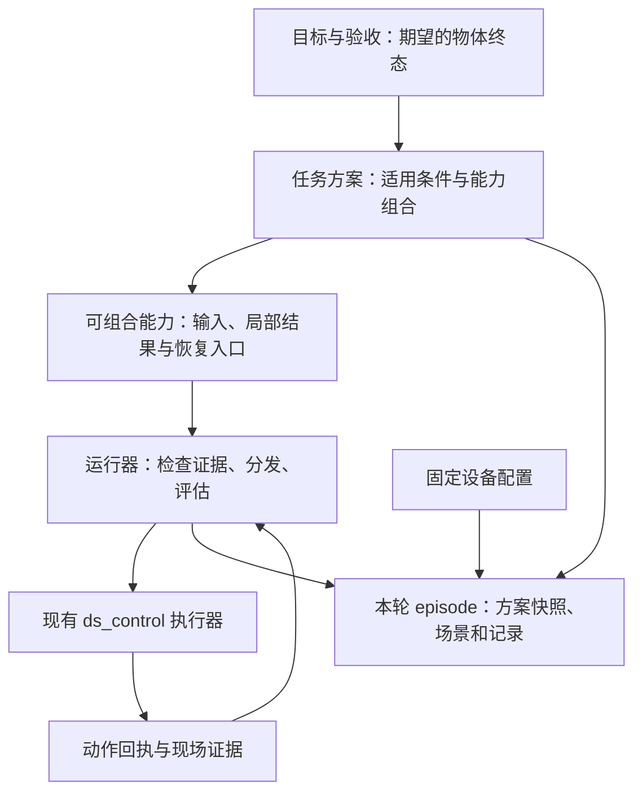

# Flip Anything：分层技能库与执行架构

愿景是逐步覆盖不同物体的翻转任务。本轮已实现目标与验收、任务方案、可组合能力三层；目前只有抓起倒置放置这一方案族，以及空罐特化。目录中出现通用目标，不代表系统已能翻转任意物体。具体分层约定见 [LAYERS.md](LAYERS.md)。

## 已实现的边界

`library/goals/flip_object.json` 定义目标方向或支撑关系及终态条件，不规定抓取、离桌或释放等固定动作。`library/plans/` 保存实现目标的方法：`pick_invert_place` 组合现有能力，`empty_can_inversion` 继承该方案并增加物体适用条件。继承同时保留父子条件，不能因特化而放宽父方案约束。

`library/capabilities/` 保存九项操作契约。原 `flip` 已明确命名为 `invert_held_object`，只表示持物倒置；原 `verify` 为 `verify_inverted_placement`，用于倒立放置验收。`aliases.json` 保留旧名称调用。能力提供局部结果，整体完成规则由所选方案提供，不由某个通用动作名决定。

这借鉴 Voyager 的可执行技能与环境反馈思路。本轮未实现自动课程、自动规划或模型自主生成代码并入库。学生仍需选择适用方案、取得当前观测并提供局部动作参数；IK 由现有控制器接口处理。

## 一次实验如何保持可追溯

新 episode 创建时保存 `catalog_snapshot.json`，包含目标、解析后的方案、所用能力及源文件摘要。`scene.json` 从未观测状态开始；若指定设备配置，则另存 `device_profile.json` 副本。状态、事件与结果分别保存，不能把场景估计混入设备配置，或把某次成功轨迹当作通用技能。运行器尚未自动填写或验证场景几何。

新实验记录集中放在项目 `logs/episodes/<episode_id>/`，设备原始回执和 RGB-D 记录集中放在 `logs/experiments/ds_control/<run_id>/`；固定配置放在 `skill_harness/devices/`。旧实验记录统一位于 `logs/experiments/legacy/`，聊天记录位于 `logs/conversations/`，SDK 日志位于 `logs/sdk/`。代码与文档直接使用统一的新路径；迁移时保留改写前文本和路径映射，便于追溯。

新 episode 使用创建时的能力与方案快照。旧格式 episode 通过归档契约兼容，旧 `flip`、`verify` 名称仍可迁移调用；本轮不要求接管或重启已有实机会话。

## 执行器负责什么

运行器在发出动作前持久化状态；结果未知时禁止自动重发。成功回执仍需后置评估，不能直接代表能力成功。证据与回执摘要、修订号关联；持物反馈与释放证据进行已有检查。方案指定最终验收能力及必须完成的前置能力，运行器据此记录整体结果。

这些检查只核验来源、关联及部分控制器事实，不能证明图像解释正确。当前方案和能力仍为候选，能力包装器标记为 `offline_only`。候选开发实验需要显式选择候选；没有自动定位、通用轨迹生成或已验证的自主触桌检测。设备模板同样未验证，不能作为有效标定使用。

恢复操作只调整上层实验状态，不清硬件故障、不解除停止状态，也不证明碰撞风险已消除。未知动作先核查结果，再恢复观察；新硬件 run 建立新的 episode。

## 留待下一部分共同确定

技能如何取得有效性证据、如何评价跨物体迁移、何时修改或晋升，以及学生怎样选方案，将逐项讨论后实施。现有 `learning.py` 的候选与批准入口只是早期记录机制：另一个运行成功并不足以证明某条经验有效，也不能证明因果关系、适用范围或实现正确性。本轮不扩展该机制，不据此提升候选状态。

离线测试证明的是分层、兼容和运行契约；实机效果须由新的授权实验验证。物理成功与人工介入分别记录，不能以文件名、状态标签或文字总结代替物体终态证据。

